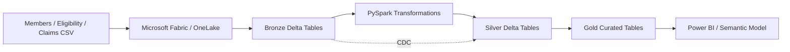

# fabric-healthcare-lakehouse
Microsoft Fabric healthcare lakehouse pipeline using PySpark, Delta Lake, medallion architecture, CDC, and data-quality checks.
[README.md](https://github.com/user-attachments/files/32891864/README.md)
# Microsoft Fabric Healthcare Lakehouse Pipeline

Portfolio project modeling a Medicare Advantage-style payer data pipeline using **Microsoft Fabric, PySpark, Delta Lake, SQL, and Bronze/Silver/Gold medallion architecture**.

> All data in this repository is synthetic. No real patient information or PHI is used.

## What it demonstrates
- Ingestion of member, eligibility, and claims datasets
- Bronze / Silver / Gold lakehouse architecture
- PySpark cleaning, typing, deduplication, and transformations
- Delta Lake table patterns
- Data-quality validation
- CDC-style Delta `MERGE`
- Gold datasets designed for Power BI / semantic models

## Architecture



## Repository structure
```text
data/raw/                  Synthetic source data
fabric_notebooks/          Fabric-ready PySpark notebook code
src/local_preview.py       Local pandas preview
docs/architecture.md       Architecture notes
docs/resume_bullets.md     Concise resume wording
```

## Run a quick local preview
```bash
pip install pandas
python src/local_preview.py
```

## Run it in Microsoft Fabric
1. Create a Fabric workspace.
2. Create a Lakehouse named `healthcare_lakehouse`.
3. Upload `data/raw/*.csv` to `Files/raw/`.
4. Create notebooks and paste in the files from `fabric_notebooks/`.
5. Attach each notebook to the Lakehouse.
6. Run notebooks 01 through 04 in order.
7. Run notebook 05 to demonstrate a CDC-style Delta merge.
8. Confirm these tables exist:
   - `bronze_members`, `bronze_eligibility`, `bronze_claims`
   - `silver_members`, `silver_eligibility`, `silver_claims`
   - `gold_member_summary`, `gold_plan_summary`
9. Connect Power BI to `gold_plan_summary` and build a one-page report.

## Interview talking points
- Bronze keeps the raw source as close to original as possible.
- Silver cleans, types, deduplicates, and validates.
- Gold contains business-ready datasets.
- Delta Lake adds reliable table operations and supports merge/upsert patterns.
- CDC reduces unnecessary full reloads by applying only new or changed records.
- Data quality checks cover uniqueness, valid ranges, source relationships, and row health.
- Synthetic payer-style data avoids using real PHI.

## Resume wording
After you have successfully run the project in Fabric:

**Microsoft Fabric Healthcare Lakehouse Pipeline**
- Built an end-to-end healthcare data pipeline using Microsoft Fabric, PySpark, Delta Lake, and SQL with Bronze/Silver/Gold medallion architecture.
- Processed synthetic claims, member, and eligibility data with transformation, deduplication, CDC-style upserts, and data-quality checks.

## Disclaimer
Educational portfolio project only. Not affiliated with any healthcare organization. Contains no real PHI.
